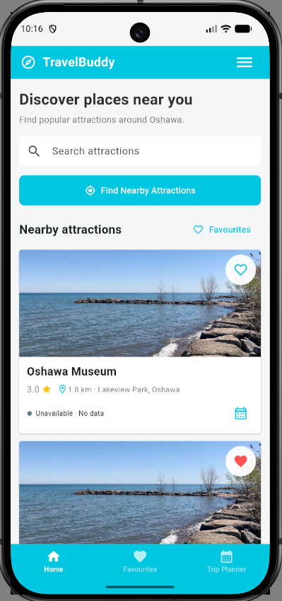
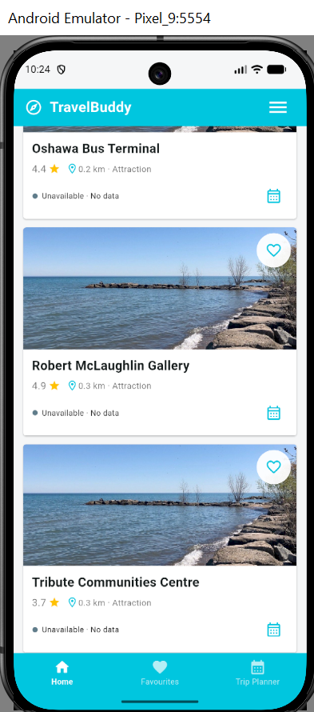
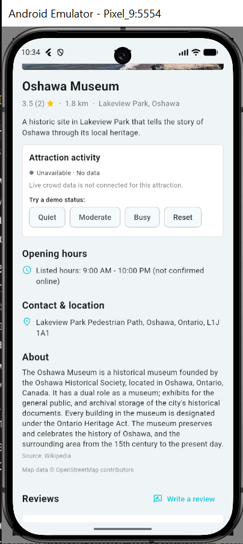
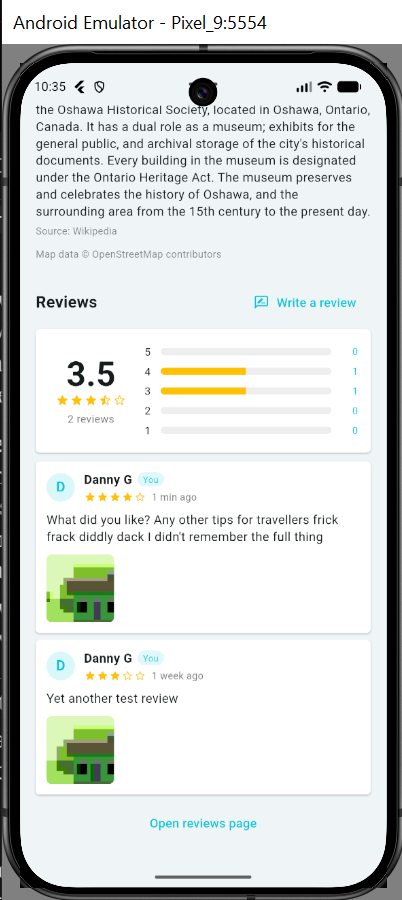
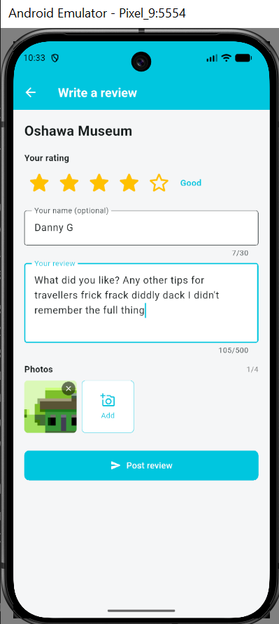
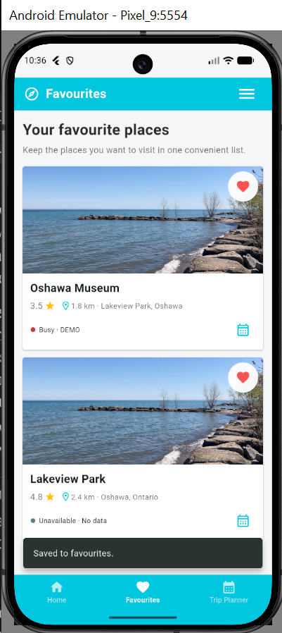
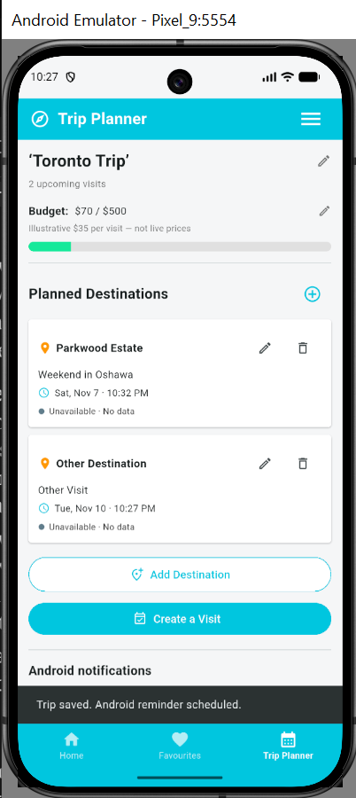
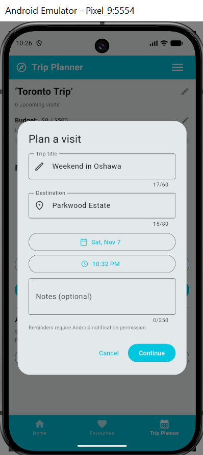
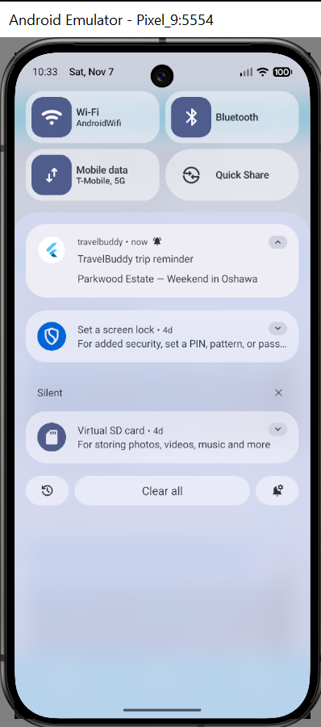
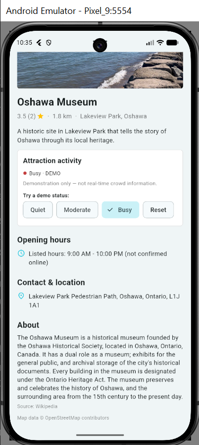

# TravelBuddy

**Discover places worth visiting. Save your favourites. Plan the next stop.**

**CSCI 3101U — Mobile Devices · Ontario Tech University · Fall 2026**  
**Project stage:** Part 2 — Mid-Course Update & Check-in (November 9, 2026)  
**Primary demonstration platform:** Android emulator / Android phone

TravelBuddy is a Flutter application for travellers who want to explore nearby attractions, learn about places of interest, save destinations, and organize upcoming visits. The current checkpoint build brings together location-based discovery, attraction details, locally saved favourites and reviews, a trip planner, Android reminders, and a clearly labelled demonstration of crowd-activity status.

> **Mid-course build:** This is a working project in development, **not a finished travel-information service**. Features that rely on external data may vary with location, connectivity, and API availability. Live crowd levels are not yet connected to a real data provider.

## Contents

- [Explore the app](#explore-the-app)
- [Feature status](#feature-status)
- [Technology stack](#technology-stack)
- [Get started](#get-started)
- [Test account and permissions](#test-account-and-permissions)
- [Suggested evaluation walkthrough](#suggested-evaluation-walkthrough)
- [Project structure](#project-structure)
- [Testing](#testing)
- [Data sources and limitations](#data-sources-and-limitations)
- [Team and development status](#team-and-development-status)
- [Submission contents](#submission-contents)
- [Generative AI acknowledgement](#generative-ai-acknowledgement)

## Explore the app

### Discover nearby attractions

The **Home** tab initially displays sample attractions so the interface can be explored without first requesting a location. Tap **Find Nearby Attractions** to request device location and query Wikipedia's geographically nearby pages. Attraction cards provide a name, a displayed rating and distance, favourite controls, and an entry point to details.

<p>
  
  
</p>

### View details and write reviews

Selecting an attraction opens its detail sheet.

**Place information (HTTP).** The sheet sends HTTP requests to OpenStreetMap **Nominatim** (address, phone, website and the OSM `opening_hours` tag) and the **Wikipedia REST summary** API (short description and photo). Where they are available, it shows:

- A weekly **opening-hours table** with today highlighted and an **Open now / Closed now** chip. Common OSM formats (for example `Mo-Fr 09:00-17:00; Su off` or `24/7`) are parsed; unusual formats are shown as the raw text.
- Address, phone number, website, and a Wikipedia description.
- A loading indicator while the requests run, and a **Retry** button if the network request fails. If the API has no hours, the sheet falls back to the attraction's listed hours, marked as *not confirmed online*.

Fetched details are cached in memory and saved with `shared_preferences`, so an attraction that was opened before can still show its details offline.

**Ratings and reviews.** The **Reviews** section shows an aggregated rating (average, review count, and a 1–5 star breakdown). The same average replaces the placeholder rating on attraction and visit cards once an attraction has reviews.

- **Write a review** opens a form: a required 1–5 star rating, an optional name (up to 30 characters), and review text (10–500 characters, validated). Users can attach up to four photos from the **camera or gallery**; a confirmation dialog appears if they leave with unsaved changes.
- **See all reviews** opens a list that can be **sorted** (Newest, Highest rated, Lowest rated) and **filtered by star value**. Users can delete their own reviews after a confirmation dialog, and a SnackBar confirms the result.
- Reviews and their photos are stored **on the device only**; photos are copied into the app's documents folder so they survive a restart.

<p>
  
  
</p>



### Save favourite places

Tap the heart on an attraction to save or remove it. The **Favourites** tab shows saved attractions, and the application displays a SnackBar for the action. On Android, saving a favourite can also issue an immediate **local** notification if permission is granted.



### Plan visits and receive reminders

The **Trip Planner** tab allows a user to:

- Create a planned visit with a trip title, destination, date, time, and optional notes.
- Use date/time pickers and required-field validation; confirm or cancel changes.
- Edit and delete visits, view upcoming and past visits, and retain saved trips after restarting the app.
- Rename the trip and adjust its budget. The displayed **$35-per-visit** cost is illustrative, **not a live price or booking estimate**.
- Schedule an Android local reminder when the planned visit and notification permissions allow it; cancel the associated reminder on deletion.

<p>
  
  
</p>



### See attraction activity status

Activity badges appear on attraction and visit cards. The details panel has **Quiet**, **Moderate**, **Busy**, and **Reset** controls for a **demonstration only**. Until a verified crowd-data service is connected, attractions show **Unavailable · No data**, and manually selected values are explicitly labelled **DEMO**; they are not real-time crowd measurements.



## Feature status

Tested on a Pixel 9 Android emulator (Android 17, API 37) with Flutter 3.47.4. Features that rely on GPS, the internet, or notification permissions should also be checked on the grader's device.

| Area | Check-in state | Where to find it / scope |
| --- | --- | --- |
| Home and destination cards | **Implemented** | Home tab; sample cards shown before a location search |
| Nearby attraction discovery | **Implemented with limitations** | Home → **Find Nearby Attractions**; GPS permission, Wikipedia geo-search, internet required |
| Place details and opening hours | **Implemented with limitations** | Tap an attraction; Nominatim/Wikipedia HTTP requests, weekly hours table, Open now chip, retry on failure, offline cache. Fields depend on available source data |
| Favourites | **Implemented** | Heart buttons and Favourites tab; stored locally |
| Ratings and reviews | **Implemented locally** | Attraction details → Reviews; validated review form, star rating, camera/gallery photos, aggregated average and star breakdown, sort and star filter, delete with confirmation |
| Trip Planner | **Implemented** | Trip Planner tab; forms, pickers, validation, create/edit/delete, local persistence |
| Notifications | **Implemented for Android locally** | Favourite-save alerts, test notification, scheduled visit reminders; **not remote push** |
| Activity status | **Demonstration** | Attraction detail panel; manually selected crowd levels, **not live data** |
| Navigation menu | **Implemented as a bottom sheet** | Top-right menu; links to Home, Favourites, and Trip Planner |
| Adjustable UI settings | **Not yet implemented** | Menu currently has navigation choices, not working theme/text-size controls |
| Search by typed keyword | **Not yet implemented** | Search field is visible but not connected yet; typing shows a placeholder message |

## Technology stack

| Layer | Technology used in this repository |
| --- | --- |
| App and UI | **Flutter**, **Dart**, Material 3 |
| State and navigation | `StatefulWidget`, `ChangeNotifier`, bottom navigation, sheets and dialogs |
| Geolocation | `geolocator` |
| HTTP and attraction discovery | `http`; Wikipedia GeoSearch API |
| Additional attraction information | OpenStreetMap **Nominatim** and Wikipedia REST summary |
| Persistent local data | `shared_preferences`; app document storage for review photos via `path_provider` |
| Images and reviews | `cached_network_image`, `image_picker` |
| Android reminders | `flutter_local_notifications`, `flutter_timezone`, `timezone` |
| Tests and code checks | `flutter_test`, `flutter_lints`, `flutter analyze` |

The `pubspec.yaml` specifies **Dart SDK `^3.13.3`**. Use an installed Flutter version whose bundled Dart SDK meets that constraint; `flutter --version` will show the local version. The Android project uses Kotlin Gradle configuration and Gradle wrapper files already included under `travelbuddy/android/`.

## Get started

TravelBuddy is developed with Flutter and Dart. The **required evaluation target is Android**, and the project can be built from either **macOS** or **Windows** using Android Studio and an Android emulator or physical Android device.

### Prerequisites (both platforms)

- [Flutter SDK](https://docs.flutter.dev/get-started/install) installed, with `flutter/bin` on your system `PATH`. Use a Flutter release bundling Dart compatible with the project's `^3.13.3` constraint in `pubspec.yaml`.
- [Android Studio](https://developer.android.com/studio), with the **Flutter** and **Dart** plugins, Android SDK, command-line tools, and a configured **Android Virtual Device (AVD)**.
- [Git](https://git-scm.com/downloads) to clone the repository (not needed if running from the submitted ZIP).
- Internet access to download packages and load attraction information/images; location services enabled to test nearby discovery.

> **Project directory:** The repository contains a nested Flutter application. Open and run commands from **`Mobile_Devices_TravelBuddy/travelbuddy/`**, the folder containing `pubspec.yaml`—not from the repository root.
>
> **Part 2 submission ZIP:** If you received the course submission instead of cloning GitHub, extract it and open **`code/`** (the directory containing `pubspec.yaml`). Skip the `git clone` command.

### macOS — Installation and launch

**1. Prepare Flutter and Android Studio**

1. Install the Flutter SDK using the [official macOS instructions](https://docs.flutter.dev/get-started/install/macos) and add its `bin` directory to your shell's `PATH`. Restart Terminal if you changed `PATH`.
2. Install Android Studio and its Flutter/Dart plugins. In **Tools → Device Manager**, create or select an Android emulator (for example, a Pixel device) and start it with the play button.
3. Open **Terminal** (or Android Studio's built-in terminal) and verify your setup:

   ```bash
   flutter --version
   flutter doctor
   flutter doctor --android-licenses
   ```

   Accept the Android SDK licences when prompted. Address any Android toolchain problems shown by `flutter doctor`.

**2. Clone and open the project**

```bash
cd ~
git clone https://github.com/EbaadAwan/Mobile_Devices_TravelBuddy.git
cd Mobile_Devices_TravelBuddy/travelbuddy
flutter pub get
```

If the repository is already cloned, **skip `git clone`** and open the existing `travelbuddy` folder instead. You can also select **Open** in Android Studio and choose that folder.

**3. Run on an Android emulator or device**

```bash
flutter devices
flutter run
```

Choose the Android emulator/device if Flutter lists multiple targets. To specify it directly, use the device ID returned by `flutter devices`, for example:

```bash
flutter run -d emulator-5554
```

`emulator-5554` is only an example; your ID may differ. In Android Studio you can alternatively choose the emulator in the device dropdown (not **macOS desktop**), open `lib/main.dart`, and click **Run ▶**.

### Windows — Installation and launch

**1. Prepare Flutter and Android Studio**

1. Install the Flutter SDK using the [official Windows instructions](https://docs.flutter.dev/get-started/install/windows). Extract it into a normal writable folder (for example, `C:\src\flutter`) and add `C:\src\flutter\bin` to your Windows user **Path** environment variable. Reopen PowerShell or Android Studio after changing Path.
2. Install Android Studio and its Flutter/Dart plugins. Open **Tools → Device Manager**, create or select an Android emulator, and start it with the play button.
3. Open **PowerShell** (or Android Studio's terminal with PowerShell selected) and verify your setup:

   ```powershell
   flutter --version
   flutter doctor
   flutter doctor --android-licenses
   ```

   Accept the Android SDK licences when prompted. Address any Android toolchain problems shown by `flutter doctor`.

**2. Clone and open the project**

```powershell
cd $HOME
git clone https://github.com/EbaadAwan/Mobile_Devices_TravelBuddy.git
cd .\Mobile_Devices_TravelBuddy\travelbuddy
flutter pub get
```

If you already have the repository, **skip `git clone`** and navigate to your existing `travelbuddy` folder. You can also open that folder through Android Studio's **Open** action.

**3. Run on an Android emulator or device**

```powershell
flutter devices
flutter run
```

Choose an Android target when prompted. To select a device directly, replace the example ID with the one reported by `flutter devices`:

```powershell
flutter run -d emulator-5554
```

Alternatively, select the emulator in Android Studio's device dropdown, open `lib/main.dart`, and click **Run ▶**.

### Running on a physical Android phone (macOS or Windows)

Enable **Developer options → USB debugging** on the phone, connect it by USB, approve the debugging prompt on the phone, and confirm it appears in `flutter devices`. Then run `flutter run -d DEVICE_ID`, replacing `DEVICE_ID` with its actual ID. Location and notification permissions should be allowed when testing those features.

### Optional browser preview (macOS or Windows)

```bash
flutter run -d chrome --web-port=3000
```

If compilation succeeds, open `http://localhost:3000`. This is useful for checking supported interface elements, but **Android local notifications must be tested on an Android emulator or phone**. Other plugin behavior may differ on the web.

### Troubleshooting

| Symptom | Suggested check |
| --- | --- |
| `flutter` is not recognized | Confirm the Flutter SDK `bin` folder is in your `PATH` and restart the terminal |
| `git` is not recognized | Install Git and reopen Terminal/PowerShell; alternatively use the extracted submission ZIP |
| No Android device listed | Start the emulator in Android Studio, rerun `flutter devices`, and check `flutter doctor` |
| Gradle cannot build | Check free disk space, Android SDK installation, and toolchain configuration; retry after resolving the reported error |
| Location discovery is empty or fails | Enable device location, grant permission, and check the emulator's location and internet connection |
| No scheduled notification | Enable Android notification permission and check the trip time and notification settings; inexact alarms may be delayed |
| Place information or images are missing | Wikipedia/Nominatim and network images may return incomplete data; the app includes fallbacks |

## Test account and permissions

**No login or registration is implemented in this checkpoint build. No test credentials are needed:** launch the app and use the main tabs directly. 

| Access | Why it is requested | What to do during evaluation |
| --- | --- | --- |
| Location | Find geographically nearby attractions | Enable location and allow access when prompted |
| Internet | Fetch Wikipedia/Nominatim responses and network images | Keep the device online |
| Android notifications | Show favourite alerts and planned-visit reminders | Allow when prompted; inspect the notification shade |
| Camera/photo library | Attach an optional image to a review | Grant access only when testing photo attachments |

**No API key is needed** for the Wikipedia/Nominatim requests. These public services can be unavailable, incomplete, or subject to usage policies; there is no guarantee that a particular attraction will return full details.

## Suggested evaluation walkthrough

A short path through the currently implemented functionality:

1. Open **Home** to view sample destination cards; optionally tap **Find Nearby Attractions** to exercise location permission and HTTP requests.
2. Tap an attraction to inspect its details, opening hours, reviews, and the activity panel. Set **Busy** and confirm the label says **DEMO**.
3. In **Reviews**, tap **Write a review**. Try posting with no stars or very short text to see validation, then choose a rating, add text (and optionally a photo), and post. The aggregated rating updates on the sheet and on the attraction's card. Open **See all reviews** to try sorting, the star filter, and deleting your review.
4. Save an attraction with its heart icon; visit **Favourites** and look for the SnackBar / Android local notification.
5. Open **Trip Planner**; tap **Create a Visit**. Test an empty title/destination to observe validation, then select a future date and time, confirm, and save.
6. Edit or delete the visit; restart the app to check local persistence (trips, favourites and reviews should all still be there). The **Send test notification** control is available in Trip Planner for Android notification testing.
7. Open the top-right menu to see the navigation choices. Adjustable UI settings (theme, text size) are not implemented yet.

## Project structure

The top-level GitHub repository contains a `travelbuddy/` Flutter application:

```text
Mobile_Devices_TravelBuddy/
├── README.md                     # Repository overview and setup (this file)
├── screenshots_for_readme/       # Android screenshots shown in this README
└── travelbuddy/
    ├── lib/
    │   ├── main.dart              # App theme, shell, tabs, destination cards/details
    │   ├── features/
    │   │   ├── trips/             # Visit model, editor, storage, planner screen
    │   │   └── activity/          # Crowd-status state and demo UI
    │   ├── screens/               # All-reviews list and write-review form
    │   ├── services/              # Nearby search, place details + opening-hours
    │   │                          # parser, reviews + rating summary,
    │   │                          # favourites, Android notifications
    │   └── widgets/               # Place-info/hours section, review and rating widgets
    ├── test/                      # Widget, trip-model and activity-status tests
    ├── android/                   # Android app manifest and Gradle configuration
    ├── ios/                       # Flutter platform scaffolding
    ├── web/                       # Flutter web scaffolding
    ├── linux/                     # Flutter platform scaffolding
    ├── macos/                     # Flutter platform scaffolding
    ├── windows/                   # Flutter platform scaffolding
    └── pubspec.yaml               # Dependencies and Dart SDK constraint
```

The coursework's required execution target is **Android**. Other platform folders are part of the Flutter project, but their presence does **not** mean every feature has been verified on those platforms.

## Testing

From the `travelbuddy/` directory:

```bash
flutter analyze
flutter test
```

To run the two focused model/status tests individually:

```bash
flutter test test/trip_plan_test.dart test/activity_status_service_test.dart
```

The checked-in tests cover trip JSON serialization, editing without changing visit identity, activity-status defaults, and demo-status labelling. A basic widget test also checks for the application shell/tabs. Reviews, rating aggregation and opening-hours parsing do not have automated tests yet; they are covered by manual testing on Android. **Native notification delivery, permission prompts, API responses, and the full user journey require manual Android testing**; passing unit tests does not establish those outcomes.

## Data sources and limitations

- **Nearby results:** Wikipedia GeoSearch uses current device coordinates; sample cards are shown before searching. Results can vary by location and internet access.
- **Ratings and images:** Until an attraction has user reviews, its card rating is an **illustrative value** (for Wikipedia results it is derived from distance, not from real reviews). Once reviews exist, cards show the **average of the reviews saved on this device**. Default card images can be reused placeholders. Neither should be read as verified public ratings or photos of every returned place.
- **Details:** Nominatim/Wikipedia provide data when available. Place details are cached in memory and in `shared_preferences`, so previously opened attractions can show details offline, but **complete offline browsing is not promised**.
- **Opening hours:** Hours come from the OpenStreetMap `opening_hours` tag, which is community-maintained and may be missing or out of date. Public-holiday rules are ignored, and seasonal or sunrise/sunset rules are shown as raw text rather than as a table.
- **Reviews and favourites:** User-created content is saved **on the device**, not synced to a shared server or another user's account.
- **Reminders:** Notifications are **local Android notifications**, not Firebase Cloud Messaging or email. Current scheduling normally uses a two-day lead time for distant visits and a short lead time for near-term demo visits; Android can delay inexact alarms.
- **Crowd information:** The current **Quiet / Moderate / Busy** controls are **simulated**. Connecting a trustworthy external crowd-data source is future work.
- **Still in progress:** Keyword search; an app drawer with user-adjustable UI settings; production-grade crowd data; additional backend/cloud features and cross-device validation.

## Team and development status

| Contributor | Responsibility area |
| --- | --- |
| Abdul Jawad Syed | Location permissions, nearby discovery, external APIs |
| Brandon D'sa | Trip Planner, trip/favourite notifications, activity status |
| Daniel Grgic | Reviews, ratings and attraction details |
| Ebaadurrub Awan | Favourites, local storage and offline support |
| Levent Cakir | UI/UX, navigation and attraction presentation |

**Current milestone:** Part 2 check-in — November 9, 2026. **Final project deadline:** December 6, 2026. Completed work, remaining work and each member's contributions are detailed in the progress report.

## Submission contents

| Item | What it contains |
| --- | --- |
| `README.md` | This file: overview, setup, permissions and AI acknowledgement |
| `screenshots_for_readme/` | Android screenshots used in this README |
| `report/` | Mid-course progress report (PDF) |
| `video/` | Demo video (MP4, under two minutes) |
| `code/` | The Flutter project. Open this folder, then run `flutter pub get` and `flutter run` |

## Generative AI Acknowledgement

In accordance with the CSCI 3101U – Mobile Devices course guidelines, our group acknowledges the use of generative AI tools during selected stages of the TravelBuddy application's development.

AI tools were used to support programming, understanding Flutter concepts, troubleshooting, and documentation where applicable. Each group member is responsible for understanding, reviewing, testing, and explaining their contributions.

### 1. Brandon D'sa — 100926532

**AI Tool Used:** ChatGPT 5.6 Sol (Codex) - Medium 

**Areas of Contribution:** Trip Planner, Trip/Favourite Notifications, and Live Activity Status.

#### Purpose of AI Use

I used ChatGPT as a learning and development resource to better understand Flutter and Dart concepts relevant to my assigned features. This included learning how Flutter widgets handle user interactions, how application data can be managed, and how Android notifications are configured.

AI also provided assistance with selected implementation details, troubleshooting, and testing. I reviewed and tested the resulting functionality using Android Studio and an Android emulator.

#### AI Prompts — Learning-Focused Examples

*The following are reconstructed examples of learning-focused questions relevant to the development process, not verbatim records of previously submitted prompts.*

**Prompt 1 — Understanding Flutter Date and Time Pickers**

> "Can you explain how Flutter's `showDatePicker()` and `showTimePicker()` methods work in Dart? I want to understand how selected dates and times can be displayed in a mobile application's interface."

**Topic:** Flutter widgets, asynchronous functions, and user input.

**Prompt 2 — Learning Form Validation in Flutter**

> "How does Flutter's `Form` widget work with `TextFormField` and validators? Can you explain how validation messages are displayed when users leave required fields empty or enter invalid information?"

**Topic:** Forms, input validation, and error handling.

**Prompt 3 — Understanding Local Data Storage**

> "Can you explain how the `shared_preferences` package works in Flutter? I'm learning how mobile applications store small amounts of data locally and retrieve that information when the application restarts."

**Topic:** Local persistence, data management, and asynchronous operations.

**Prompt 4 — Learning Android Notification Concepts**

> "What is the difference between local notifications and push notifications in Flutter? Can you show me, via a coding example related to my project as to how notification permissions, notification channels, and scheduled reminders work on Android devices and how to implement it?"

**Topic:** Android notifications, permissions, and scheduling.

**Prompt 5 — Understanding Flutter State Management**

> "Can you show me how `ChangeNotifier`, `setState()`, and stateful widgets work in Flutter? I want to understand how to code the  application's interface so it can automatically updates when a status changes, such as switching between Quiet, Moderate, and Busy. Or when I set a reminder for an upcoming event planned for the app"

**Prompt 6 — Understanding How to Structure a Trip Planner Feature in Flutter**

> "Can you provide a simple example of how to structure a Trip Planner feature in Flutter using Dart? I want to understand how to organize the different components, such as a trip data model, date and time pickers, form validation, and a screen for displaying planned visits. Please explain how these components interact and how I could approach implementing them step by step in an existing Flutter group project."

**Topic:** Flutter application architecture, Dart file organization, reusable widgets, and feature implementation planning.

**Purpose:** To better understand how to break down my assigned Trip Planner functionality into smaller, manageable components and organize the implementation within our group's existing Flutter application.

**Topic:** State management, reactive user interfaces, and status indicators.

#### Independent Work and Verification

I was responsible for integrating and verifying the Trip Planner, notification functionality, and activity-status components within our group's TravelBuddy application. I reviewed the implementation, tested its functionality using an Android emulator, and worked through issues encountered during development.

Generative AI assisted with understanding technical concepts, selected coding tasks, troubleshooting, and testing. The final work was reviewed and tested as part of our group's development process.

### 2. Abdul Jawad Syed

**AI Tool(s):** Claude

**Areas of Contribution:** Implemented the "Find Nearby Attractions" feature by integrating the geolocator package for GPS permissions and coordinates, and using the http package to make real API requests to the Wikipedia Geosearch API to fetch and display live location-based data.

**Purpose:** I used AI to generate the service layer code that handles asynchronous HTTP requests and JSON parsing, as well as to troubleshoot emulator-specific network errors (like SSL handshake failures and API timeouts) that prevented the initial OpenStreetMap integration from working.

**Prompt(s):**

> Please write a service class that uses the geolocator package to get the user's current latitude/longitude, and then makes an HTTP GET request to a free public API (like Wikipedia or OpenStreetMap) to fetch nearby points of interest. It should return a list of objects with name, distance, and category.

> My HTTP request to the Overpass API is failing with a 406 error and then a 502 timeout on the Android Emulator. Can you provide a fixed version of the code that handles User-Agent headers correctly, implements a timeout to prevent freezing, and tries multiple API mirrors?

**Contribution and Verification:**

AI Assistance: The AI generated the initial boilerplate for the NearbyAttractionsService class, including the logic for mapping raw JSON API responses to my Dart NearbyAttraction model. It also provided the specific HTTP headers required to bypass emulator security restrictions.
Verification: I independently set up the Android Manifest permissions and iOS Info.plist configurations required for GPS access. I verified the functionality by manually setting the emulator's GPS coordinates to Oshawa (43.8971, -78.8658) via Extended Controls and confirming that the app successfully fetched real-world landmarks like the "Robert McLaughlin Gallery" and "Oshawa Museum" rather than returning mock data. I also reviewed the code to ensure error handling (try/catch blocks) was robust enough to display user-friendly messages if the API went offline.

---

### 3. Daniel Grgic

**AI Tool(s):** Claude (Anthropic)

**Areas of Contribution:** Reviews and ratings, HTTP requests for attraction details and opening hours, aggregated ratings and review lists.

**Purpose:** I used Claude to find free, key-less public APIs that I used to provide attraction details and opening hours, and to understand how to connect them to our app. This includes how to send the HTTP requests, what each API returns, how to follow the services' usage rules, and how to turn the returned data into something the app can display.

**Prompt(s):**

*Unfortunately I deleted the conversation because I didn't think that I'd need to remember any of the prompts word for word, so the following is more or less a guess based on what I remember needing it for:*

> "What free APIs are there that don't need an API key or billing that I could use in a Flutter app to get details about tourist attractions like address, phone number, website and opening hours?"

> "How do I use OpenStreetMap Nominatim from Flutter to search for a place by name and get its opening hours? What do the extratags and addressdetails parameters do, and what are the rules I need to follow if any?"

> "How can I use the Wikipedia REST API to get a short description and image for an attraction, and how do I avoid showing the wrong article when the name matches a different place?"

> "OpenStreetMap gives opening hours as a string like Mo-Fr 09:00-17:00; Sa 10:00-16:00; Su off. How can I parse that in Dart into a weekly schedule and work out whether a place is open right now?"

> "How do I handle timeouts, failed requests and missing data from these APIs in Flutter, so the app shows a loading state, a retry option, and fallback information instead of crashing?"

**Contribution and Verification:**

AI assistance was used for the AttractionDetailsService (Nominatim and Wikipedia requests), the opening-hours parser, and the error handling in AttractionInfoSection. I used the suggested code in the attraction details sheet and connected it to the rest of the app. I tested it on an Android emulator using real Oshawa and Toronto attractions, checking that hours, addresses and descriptions loaded correctly, that the Open now and Closed now status matched the listed hours, and that turning off the network showed the Retry button and fallback hours.

---

### 4. Ebaadurrub Awan

**AI Tool(s):** ChatGPT 5.6 Sol (Codex) - Medium

**Purpose:** Local storage, offline support, snackbars

**Prompt(s):**

> “I would like to know how I may store a list of preferred tourist attractions using Flutter's shared_preferences. I am looking for help with understanding how to add the list to preferences once a user clicks a favorite button and then retrieve that list upon restarting the application.”

> “How do I cache the detailed information about attractions (address, open times, description, url of picture) received through api in Flutter? Can you please describe in detail how I can cache this data locally so that my application will be able to display this data even though there is no connection to the Internet?”

> “What does cached_network_image do in Flutter? I'd love some clarification on how it can load an image from a URL, store it on your device, and display a spinner/fallback image if it can't load?”

> “Can you please provide me with guidance on how to display a snackbar in Flutter whenever a user adds/removes an attraction from their favorites? The goal here is to have the app display something very quick and informative, e.g., 'Added to Favorites', 'Removed from Favorites'.”

**Contribution and Verification:**

I utilized AI to assist in implementing offline caching for attraction information and image data, a snack bar for user feedback, and local favorite storage. I implemented this by reviewing my own coding to integrate the new feature(s) into an already completed app, then verifying that all of these new features functioned as they should with respect to the apps overall flow through its navigation and attraction display screens.

---

### 5. Levent Cakir

**AI Tool(s):** [Insert AI Tool Used]

**Purpose:** [Describe How AI Was Used]

**Prompt(s):**

> [Insert Exact Prompt Used]

**Contribution and Verification:**

[Identify the AI tools, relevant prompts, and how AI assistance contributed to your work.]

---

### Academic Integrity Statement

All generative AI assistance is acknowledged in accordance with the course's academic integrity requirements. Group members remain responsible for understanding, verifying, debugging, and maintaining their submitted contributions.

*Note: Each contributor should replace the placeholders above with their actual AI usage and prompts, or explicitly state that no generative AI tools were used. Brandon's quoted prompts are excerpts; the complete original requests should be retained or provided if required by the instructor. The last person to add their portion should be fine to remove this note afterward*
